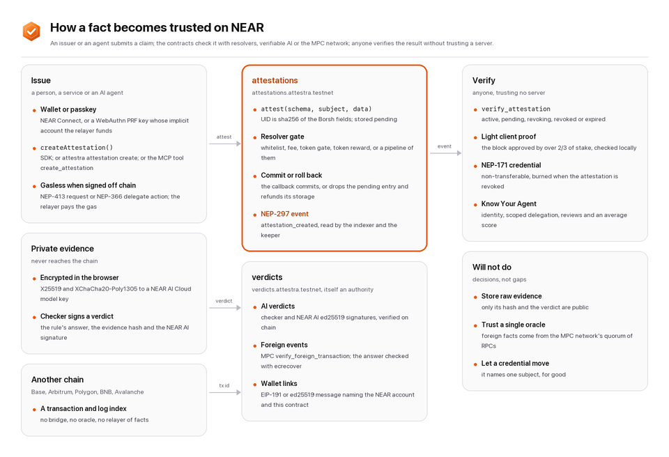

<picture>
  <source media="(prefers-color-scheme: dark)" srcset="assets/readme/hero-dark.png">
  <source media="(prefers-color-scheme: light)" srcset="assets/readme/hero-light.png">
  
</picture>

# Attestra

**The problem:** apps and AI agents on NEAR keep asking the same questions: is this person over 18, does this wallet on another chain belong to them, did that payment happen, can this agent be trusted with a task.
Each app answers them again, usually by collecting documents it should not hold or by trusting an oracle.
Attestra lets a fact be checked once and then read by any contract, app or agent, with a proof instead of a promise.

Attestra is the trust layer for NEAR: a schema-based attestation protocol for issuing, managing and verifying claims about people, wallets on any chain, and AI agents.
A schema defines the shape of a claim, an authority issues attestations against it, and resolvers add rules such as whitelists, fees, token gates and rewards.
Attestations can be delegated, scheduled for revocation, minted as non-transferable credentials and proven final with a light client proof.

On NEAR it goes past a registry:

- **Private facts, checked by verifiable AI.**
  Evidence such as an ID scan or a payslip is encrypted in the browser to a NEAR AI Cloud model; only the verdict and a hash reach the chain, and the contract checks the model's signature.
- **Facts about other chains, with no oracle.**
  The contract asks the NEAR MPC network to verify a transaction on Solana, Base, Arbitrum, Polygon, BNB or Avalanche (`verify_foreign_transaction`) and checks the signed answer itself.
- **Know Your Agent.**
  AI agents get an on-chain identity, reviews, scoped delegation and a function-call access key that can only attest and revoke, and other agents read them through MCP before they trust or pay one.

| | |
|---|---|
| Testnet contracts | under `attestra.testnet`, from a reproducible build: see [Deployed contracts](#deployed-contracts) |
| Demo | site and video: `[placeholder]` |
| Packages | `@attestra/sdk`, `@attestra/cli` (binary `attestra`), `@attestra/mcp` |
| For agents | [AGENTS.md](AGENTS.md), [skills/attestra/SKILL.md](skills/attestra/SKILL.md), `/llms.txt` and `/mcp` on the site |
| For judges | [JUDGES.md](JUDGES.md): each judging criterion mapped to code, tests and transactions |

## Try it

Two minutes, against the live testnet contracts, with no keys:

1. Run `pnpm install && pnpm build && pnpm dev` (or `docker compose up --build`); the site opens on http://localhost:3100.
2. Open **Explorer**, then any attestation: you see its schema, attester, subject and decoded data, and its status computed on read.
3. Open **Sandbox**, then **Light Client Proof**, and paste that attestation's UID: the light client proof runs in your browser and shows each check (block approvals over 2/3 of stake, the merkle path, the event in the logs).
4. Open **Sandbox**, then **Gasless Issuing**, sign in with **Create a passkey account**, and issue a membership: you see its UID and "The relayer paid", with a NearBlocks link to the transaction.
5. Open **Sandbox**, then **Agent Chat**, and ask "Which well-known schemas does Attestra have?": the answer shows the tool it called and "signature verified by" its NEAR AI model, linked to the verification centre (needs `NEARAI_API_KEY` for the agent).
6. Run `node packages/cli/dist/index.js attestation verify <uid> --json`: the same answer from the CLI.
7. Run `pnpm verify`: PASS or FAIL for every claim in this README.

## How it works



1. An issuer signs in with a NEAR wallet or a passkey and calls `attest` on the attestations contract, directly or gasless through the relayer with a NEP-413 signed request or a NEP-366 meta transaction.
2. If the schema has a resolver, the attestation is pending while one cross-contract call asks the resolver; its callback commits the attestation or removes it and refunds the storage.
3. The commit emits a NEP-297 event; the indexer, the keeper and the explorer read it, and anyone can prove the event final with a light client proof checked in their own process.
4. For facts nobody can just assert, the verdicts contract is the authority: it accepts an AI verdict only with valid checker and NEAR AI signatures, and a foreign event only with the MPC network's signature over a payload hash it recomputes.

## Only on NEAR

| Feature | NEAR primitive | Code | On testnet |
|---|---|---|---|
| Private AI checks | NEAR AI Cloud verifiable models, end-to-end encryption, the model's and the checker's signatures checked with `env::ed25519_verify` | [ai.rs](contracts/verdicts/src/ai.rs), [check.ts](apps/agent/src/check.ts), [checker](checker/src/check.rs) | [dkfUbne9](https://testnet.nearblocks.io/txns/dkfUbne926rGHW6uFrSkZ2QeUzbt152XorrdDw7WghJ) |
| Facts about EVM chains | Chain Signatures `verify_foreign_transaction` on an EVM log, answer checked with `env::ecrecover` | [foreign.rs](contracts/verdicts/src/foreign.rs), [mpc.rs](contracts/verdicts/src/mpc.rs) | [7J7xv1mj](https://testnet.nearblocks.io/txns/7J7xv1mjiZiFD8x3pNmYMe8WGicMXsBejafdAyBu9W9V) |
| Facts about Solana | Chain Signatures `verify_foreign_transaction` on an inner instruction of a finalized transaction | [solana.rs](contracts/verdicts/src/solana.rs) | [3q5wPWqX](https://testnet.nearblocks.io/txns/3q5wPWqXMDTVxLdBkKpxJZetHHRQVARiNVZTKhTB2Fta) |
| Wallet links | EIP-191 and ed25519 signatures verified on chain | [wallet.rs](contracts/verdicts/src/wallet.rs) | [8kT7ZJaW](https://testnet.nearblocks.io/txns/8kT7ZJaWoAaFh1is4q6aSpoj6p6sSV3P93d8iZaYmMs8) |
| Know Your Agent | identity and review schemas, scoped delegation, a function-call access key limited to attest and revoke | [schemas.ts](packages/sdk/src/schemas.ts), [agent-keys.ts](packages/sdk/src/agent-keys.ts) | [FDi8Mdmw](https://testnet.nearblocks.io/txns/FDi8MdmWYyfbthdJqZAFtBStP7vpfufxAUBP3WuzWx4z), [8VD7bT6B](https://testnet.nearblocks.io/txns/8VD7bT6BoPtuXdg9RhEunMDV1WuC1FGAvY7HyLjHJzVY) |
| Paid verification | x402 on NEAR: a signed delegate action carrying `ft_transfer`, settled on chain before the answer | [x402.ts](packages/sdk/src/x402.ts), [paid.ts](apps/agent/src/paid.ts) | [Cym3k2or](https://testnet.nearblocks.io/txns/Cym3k2orMnXobF7zPwVUXACoFtQVdMkSFvNS7n2XxcYP) |
| Gasless issuing | NEP-413 signed requests and NEP-366 meta transactions through the relayer | [relayer](services/src/relayer/app.ts), [ops.rs](contracts/attestations/src/ops.rs) | [BQTsSo5L](https://testnet.nearblocks.io/txns/BQTsSo5L5QytkpTvwNFHriSUFw5G8MRyXMmcXKFYasM7) |
| Passkey accounts | WebAuthn PRF to an ed25519 implicit account | [passkey.ts](apps/web/src/lib/passkey.ts) | the same transaction, signed by a passkey account |
| Resolver gate | an asynchronous cross-contract call with commit or rollback, five resolver kinds in one wasm | [gate.rs](contracts/attestations/src/gate.rs), [resolvers](contracts/resolvers/src/lib.rs) | [BooZWk68](https://testnet.nearblocks.io/txns/BooZWk68wYGBYcB2ijG5WEiJmxRkSa6kE7ox8p9VyKfX) (a refusal) |
| Light client proofs | block approvals over 2/3 of stake and the outcome's merkle path, checked locally | [lightclient.ts](packages/sdk/src/lightclient.ts) | proves the transactions above; `pnpm verify` runs one |
| Credentials | NEP-171, non-transferable, burned when the attestation is revoked | [credentials](contracts/credentials/src/lib.rs) | [rLLq9Jcd](https://testnet.nearblocks.io/txns/rLLq9Jcd275MXqiH8j3EcxxLKbdjJchgqMNAUw6hTpp), [6bBg3bmv](https://testnet.nearblocks.io/txns/6bBg3bmvPFDrNXTDF5EPMa4627JGKZWM52d4v4T4YB1v) |
| Reproducible builds | NEP-330 metadata, `near contract verify` | [build.sh](contracts/scripts/build.sh) | see [Deployed contracts](#deployed-contracts) |

## Live on testnet

Every flow below ran against the deployed contracts; each link is the transaction.

| Flow | Transaction |
|---|---|
| A passkey account (Chrome's authenticator, no wallet, no NEAR) issuing a membership through the relayer with a NEP-413 signed request | [BQTsSo5L](https://testnet.nearblocks.io/txns/BQTsSo5L5QytkpTvwNFHriSUFw5G8MRyXMmcXKFYasM7) |
| A Base Sepolia event verified by the NEAR MPC network (`verify_foreign_transaction`) and attested by the verdicts contract | [7J7xv1mj](https://testnet.nearblocks.io/txns/7J7xv1mjiZiFD8x3pNmYMe8WGicMXsBejafdAyBu9W9V) |
| The same request before the block was final: the MPC timed out, the contract emitted `foreign_tx_failed` and refunded | [GLnfjP7C](https://testnet.nearblocks.io/txns/GLnfjP7CKz1HiHoTTvQNSqpdFQoN41WJJ93NkVjabBMH) |
| An Ethereum wallet linked to a NEAR account by its EIP-191 signature | [8kT7ZJaW](https://testnet.nearblocks.io/txns/8kT7ZJaWoAaFh1is4q6aSpoj6p6sSV3P93d8iZaYmMs8) |
| A resolver refusing an attestation, which is removed and its storage refunded | [BooZWk68](https://testnet.nearblocks.io/txns/BooZWk68wYGBYcB2ijG5WEiJmxRkSa6kE7ox8p9VyKfX) |
| A multisig authority reaching its threshold and attesting | [5uWRoyvR](https://testnet.nearblocks.io/txns/5uWRoyvRPEkcpQJSMqkVCtDjioRrKPWbJzyRyd2YGNuQ) |
| A credential minted, then burned when its attestation was revoked | [rLLq9Jcd](https://testnet.nearblocks.io/txns/rLLq9Jcd275MXqiH8j3EcxxLKbdjJchgqMNAUw6hTpp), [6bBg3bmv](https://testnet.nearblocks.io/txns/6bBg3bmvPFDrNXTDF5EPMa4627JGKZWM52d4v4T4YB1v) |
| A scheduled revocation | [ETjb9aGT](https://testnet.nearblocks.io/txns/ETjb9aGTawxQiNi6TWjQsgGtvm2Mm9caw8WHc7HGfMCm) |
| A token reward paid by a resolver | [2Pdm1UN8](https://testnet.nearblocks.io/txns/2Pdm1UN8s7hL9k736nZGX5i1CDvHJW33d6bA68Svw4Ak) |
| A paid verification over x402: the agent settles the payer's signed `ft_transfer` on chain, then answers with the claim and its light client proof | [Cym3k2or](https://testnet.nearblocks.io/txns/Cym3k2orMnXobF7zPwVUXACoFtQVdMkSFvNS7n2XxcYP) |
| Staking for an authority tier | [F8JEGaGy](https://testnet.nearblocks.io/txns/F8JEGaGyc3XmdVxRyF8s4Q81yKhskAGiB5KnGSk2jMYk) |

`pnpm cli:e2e testnet` repeats every CLI group against the deployment, `pnpm --filter @attestra/web e2e:live` repeats the sandbox tools in a real browser with a passkey account, and `pnpm verify` proves a recent attestation final with a light client proof checked locally.

## Deployed contracts

Every contract runs the reproducible build of the commit recorded in [deployments/testnet.json](deployments/testnet.json), with its code hash and deploy transaction.
Verification status: reproducible build, verifiable with `near contract verify`; the NearBlocks (SourceScan) verification follows once the repository is public.

| Contract | Account | Role |
|---|---|---|
| Schemas | [schemas.attestra.testnet](https://testnet.nearblocks.io/address/schemas.attestra.testnet) | schema registry and large-schema blobs |
| Attestations | [attestations.attestra.testnet](https://testnet.nearblocks.io/address/attestations.attestra.testnet) | attestations, authorities, delegation, signed requests, multisig, scheduled revocation, the resolver gate |
| Verdicts | [verdicts.attestra.testnet](https://testnet.nearblocks.io/address/verdicts.attestra.testnet) | private AI checks, EVM and Solana facts, wallet links |
| Credentials | [credentials.attestra.testnet](https://testnet.nearblocks.io/address/credentials.attestra.testnet) | NEP-171 credentials, burned on revoke |
| Staking | [staking.attestra.testnet](https://testnet.nearblocks.io/address/staking.attestra.testnet) | stake for authority tiers |
| Test token | [token.attestra.testnet](https://testnet.nearblocks.io/address/token.attestra.testnet) | NEP-141 with a faucet, for fees, rewards, staking and x402 on testnet |
| Resolvers | [whitelist.](https://testnet.nearblocks.io/address/whitelist.attestra.testnet), [fee.](https://testnet.nearblocks.io/address/fee.attestra.testnet), [gated.](https://testnet.nearblocks.io/address/gated.attestra.testnet), [reward.](https://testnet.nearblocks.io/address/reward.attestra.testnet), [pipeline.](https://testnet.nearblocks.io/address/pipeline.attestra.testnet) | one wasm, five resolver kinds |

## Quickstart

Requirements:
- Node 22 and pnpm 10.
- Rust through rustup; the contracts pin their toolchain in `contracts/rust-toolchain.toml` (installed on first use), and the checker needs `rustup target add wasm32-wasip2` (its published build uses OutLayer's pinned compiler image, so it carries no toolchain file).
- `cargo install cargo-near --version 0.22.0` for the contract builds; `cargo-audit` and `cargo-deny` for `pnpm security`.
- Docker for the reproducible builds; Postgres only for the indexer's database tests (see `apps/indexer/README.md`; they are skipped without it).
- Playwright's Chromium for `pnpm e2e` (`pnpm --filter @attestra/web exec playwright install chromium`).

Everything below runs on a fresh clone with no deployment and no keys:

```bash
pnpm install && pnpm build
pnpm test                 # every TypeScript suite (172 tests; 3 indexer database tests skip without Postgres)
pnpm test:contracts       # every contract unit and property test (323)
pnpm test:checker         # the OutLayer checker (24)
contracts/scripts/build.sh && pnpm test:sandbox   # 20 flows across every contract on a local NEAR node
pnpm cli:e2e              # 95 CLI steps against a fresh local deployment
pnpm e2e                  # 221 Playwright tests on a production build of the site
```

`pnpm dev` starts the site on :3100 with the indexer, agent and services against testnet; `docker compose up --build` runs the same stack in containers.
With no keys every service runs read-only and says so on `/health`.

Read an attestation from code:

```ts
import { AttestraClient } from '@attestra/sdk';

const client = new AttestraClient({ network: 'testnet' });
const valid = await client.isValid('<uid>');
const att = await client.getAttestation('<uid>');
if (valid.data?.valid) console.log('active', att.data);
```

Give an agent the tools, from this repository after `pnpm build` (the hosted endpoint is `/mcp` on the site; after the npm release, `npx -y @attestra/mcp` replaces the path):

```bash
claude mcp add attestra -- node packages/mcp/dist/cli.js
```

```bash
codex mcp add attestra -- node packages/mcp/dist/cli.js
```

Claude Desktop, in `claude_desktop_config.json`:

```json
{ "mcpServers": { "attestra": { "command": "node", "args": ["/path/to/attestra/packages/mcp/dist/cli.js"] } } }
```

Teach the agent the protocol with the skill:

```bash
npx skills add ./skills/attestra
```

From the command line, every command takes `--json`:

```bash
node packages/cli/dist/index.js attestation verify <uid> --json
```

## Verify it yourself

The local runs in the Quickstart exercise every feature: resolvers, delegation, gasless and signed requests, credentials, scheduled revocation, multisig, staking, wallet links and cross-chain facts (against an MPC double that signs real secp256k1 answers).

Against a live deployment, `pnpm verify` prints PASS or FAIL for: the test suites, the deployed code against the recorded hashes and a local reproducible build of the recorded commit (`contracts/scripts/build.sh --reproducible <commit>` first, with the commit from `deployments/testnet.json`), the well-known schemas, a light client proof of a recent attestation, an AI-checked attestation's signatures, a cross-chain attestation, an agent's reputation, the indexer's lag, every hosted MCP tool with live data, and the site and service health (start them with `pnpm dev`, or set `SITE_URL` and the service URLs to a hosted stack).

```bash
pnpm verify
```

By hand, for any contract:

```bash
near contract verify deployed-at attestations.attestra.testnet network-config testnet now
```

## Trust and privacy model

- **What is public:** every attestation's schema, subject, attester and data.
  Never put secrets or raw evidence in attestation data.
- **What stays private:** evidence for a private check is encrypted in the browser to the NEAR AI model's key; the chain stores only the verdict, the rule, the model and the evidence hash.
- **Whom you trust for an AI verdict:** the model's signing key, published by NEAR AI Cloud from inside its TEE, and the checker key that the verdicts contract's owner allowlisted.
  The contract checks both signatures and that the NEAR AI signature covers the exact request it was given.
  The model's answer travels encrypted, so the chain cannot see it: the checker verifies that the signature covers the answer, and the contract relies on the checker's signature for the result.
- **How to check that model key yourself:** `tools/nearai-verify` uses the official `@nearai/inference-sdk`, independently of the agent's code, to verify the Gateway's and the model's TEE attestations (Intel TDX quote, NVIDIA GPU evidence, a fresh nonce), that an attested report binds the key the verdicts contract allowlists, and response signatures over their exact bytes; `pnpm verify` runs it.
- **Where the checker runs:** `checker/` is a WASI component for NEAR OutLayer whose signing key is derived inside the TEE from the hash of its own build, so no one, the operators included, can make other code sign with it.
  The agent can also run the same steps locally with a configured key (`CHECKER_MODE=local`, the mode on testnet today); the status page says which mode is live.
- **Whom you trust for a foreign event:** the NEAR MPC network's key; the contract recomputes the signed payload hash itself.
  For Solana the attested fact is the instruction as the program recorded it; what its data means (an amount, a recipient) is for the reader to decode.
- **Whom you trust for "final":** NEAR's validators, through a light client proof you check yourself: more than 2/3 of stake approved the block, and the outcome's merkle path leads to it.
  The validator set itself comes from the RPC node you ask (`EXPERIMENTAL_validators_ordered`); the SDK does not yet follow the `next_bp_hash` chain from a trusted checkpoint.
- **Contract owners** can change allowlisted keys and resolver settings; reviews, fixes and accepted risks are in [SECURITY.md](SECURITY.md).

## Hackathon tracks

- **Privacy and Private AI:** private facts checked by verifiable AI with end-to-end encryption; only a verdict and a hash go on chain.
- **Agent Economy:** Know Your Agent identity, reviews, scoped delegation and function-call keys; MCP and A2A interfaces; x402 paid verification and an Agent Market listing ready to publish.
- **Social Money:** gasless issuing, passkey accounts and credentials that let communities vouch for people and gate rewards.
- **Open Innovation:** facts about Solana and EVM chains with no oracle through Chain Signatures, and light client proofs any client can check.

## Repository


## Status

- Deployed on testnet from a reproducible build; with the stack running locally, `pnpm verify` passes every check.
- The site and services run locally against testnet; they are not hosted publicly yet.
- Mainnet is one switch away and not deployed: see [MAINNET.md](MAINNET.md).
- The npm packages are packed and tested from a clean install but not published; every command above runs from the repository.
- Private checks run live on testnet in local checker mode; the OutLayer checker is tested against mocked hosts and vectors from the TypeScript side and has not yet run on an OutLayer worker.

## Built with

- Contracts: Rust, near-sdk 5.30, cargo-near 0.22 (SourceScan's reproducible build image), near-workspaces for sandbox tests.
- Checker: Rust on wasm32-wasip2 for NEAR OutLayer; ed25519-dalek, x25519-dalek, chacha20poly1305, hkdf, sha2, borsh.
- TypeScript: near-kit, @noble/curves, @noble/hashes and @noble/ciphers, the MCP TypeScript SDK, commander, hono, pg; LangChain and zod as optional peers of `@attestra/sdk/ai`; `@nearai/inference-sdk` for independent TEE attestation checks.
- Site: Next.js 16, React 19, Tailwind CSS 4, NEAR Connect (`@hot-labs/near-connect`), lucide-react; vitest and Playwright for tests.
- NEAR services: NEAR AI Cloud, NEAR OutLayer, Chain Signatures (MPC `verify_foreign_transaction`), FastNEAR RPC and transactions API.
- AI-generated code: the code, tests and docs were written with AI coding assistants (Claude Code) under the author's direction and review.
- No templates; the README images are drawn by `tools/make_readme_art.py` from the site's own design tokens.

## Team

`[placeholder]`

## License

[MIT](LICENSE)
