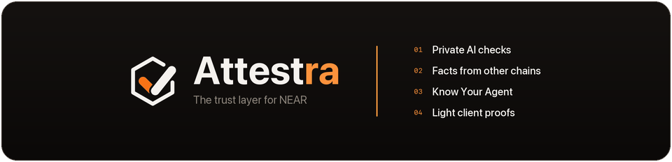
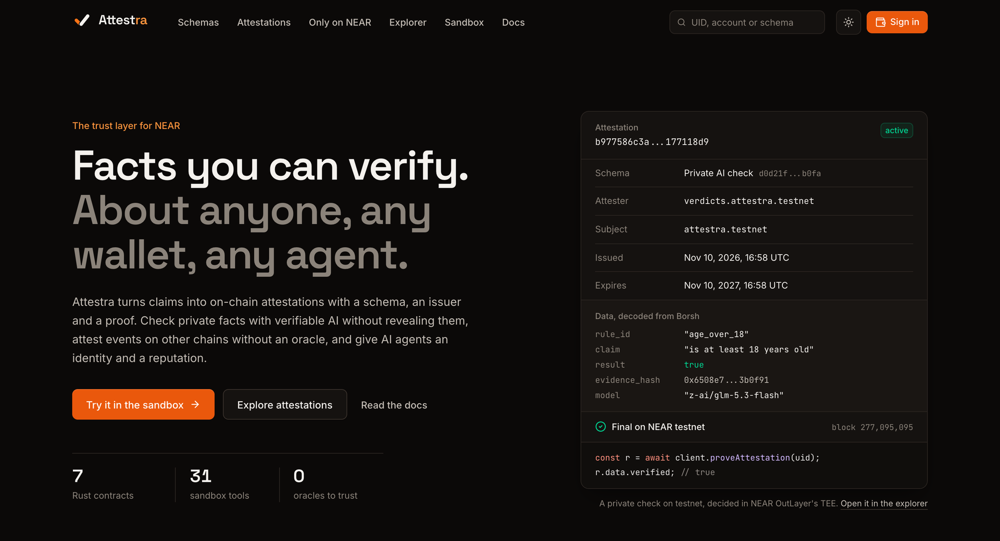
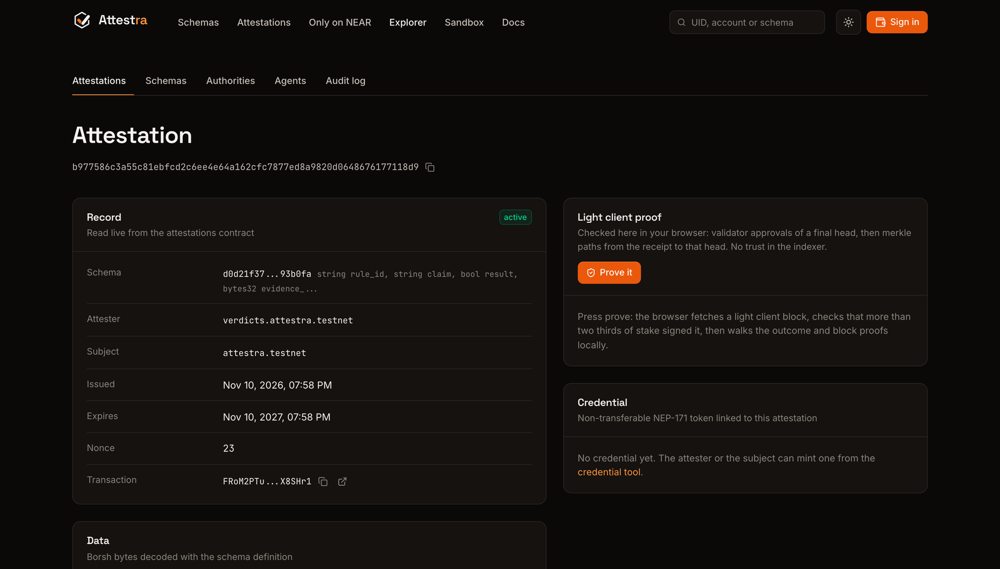
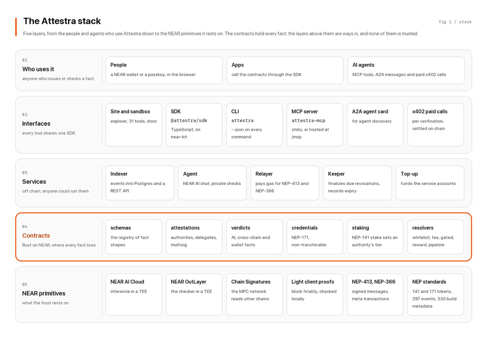
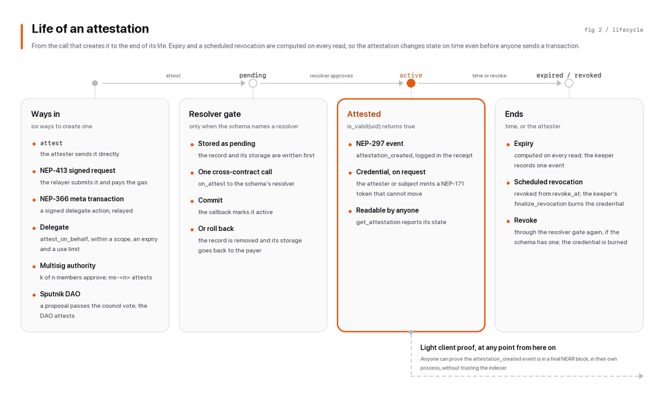
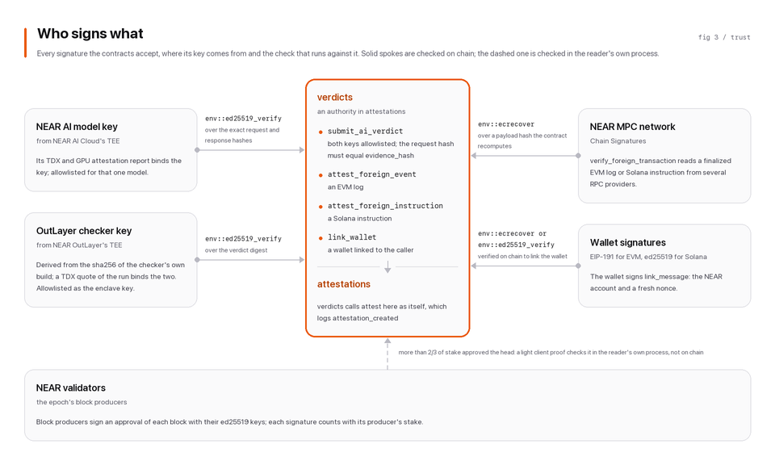

<p align="center">
  <picture>
    <source media="(prefers-color-scheme: dark)" srcset="assets/readme/hero-dark.png">
    <source media="(prefers-color-scheme: light)" srcset="assets/readme/hero-light.png">
    
  </picture>
</p>

<p align="center">
  <a href="https://attestra.site"></a>
  <a href="deployments/testnet.json"></a>
  <a href="MAINNET.md"></a>
  <a href="https://github.com/AnasKWT/Attestra/actions/workflows/ci.yml"></a>
  <a href="#verify-it-yourself"></a>
  <a href="#deployed-contracts"></a>
  <a href="https://attestra.site/mcp"></a>
  <a href="LICENSE"></a>
</p>

<p align="center">
  <a href="https://attestra.site"><b>Live site</b></a> ·
  <a href="https://attestra.site/sandbox/app">Sandbox</a> ·
  <a href="https://attestra.site/attestations">Explorer</a> ·
  <a href="https://attestra.site/docs">Docs</a> ·
  <a href="https://attestra.site/status">Status</a> ·
  <a href="https://attestra.site/llms.txt">llms.txt</a> ·
  <a href="AGENTS.md">For agents</a> ·
  <a href="JUDGES.md">For judges</a>
</p>

---

## Why Attestra

Apps and AI agents on NEAR keep asking the same questions: is this person over 18, does this wallet on another chain belong to them, did that payment happen, can this agent be trusted with a task.
Each app answers them again, usually by collecting documents it should not hold or by trusting an oracle.

> **Attestra lets a fact be checked once and then read by any contract, app or agent, with a proof instead of a promise.**

Attestra is the trust layer for NEAR: a schema-based attestation protocol for issuing, managing and verifying claims about people, wallets on any chain, and AI agents.
A schema defines the shape of a claim, an authority issues attestations against it, and resolvers add rules such as whitelists, fees, token gates and rewards.
Attestations can be delegated, scheduled for revocation, minted as non-transferable credentials and proven final with a light client proof.

<table>
  <tr>
    <th width="33%">Private facts, checked by verifiable AI</th>
    <th width="33%">Facts about other chains, with no oracle</th>
    <th width="33%">Know Your Agent</th>
  </tr>
  <tr>
    <td valign="top">Evidence such as an ID scan or a payslip is encrypted in the browser to a NEAR AI Cloud model. A checker in NEAR OutLayer's TEE signs the verdict, and only the verdict and a hash reach the chain.</td>
    <td valign="top">The contract asks the NEAR MPC network to verify a transaction (<code>verify_foreign_transaction</code>) and checks the signed answer itself: live on Base Sepolia and Solana devnet, and wired the same way for Ethereum, Arbitrum, Polygon, BNB and Avalanche.</td>
    <td valign="top">AI agents get an on-chain identity, reviews, scoped delegation and a function-call key that can only attest and revoke. An agent is trusted only with an identity its own account (or its parent) registered and paid reviews, each naming the reviewer's payment to the agent on chain. Other agents read all of it over MCP before they trust or pay one.</td>
  </tr>
</table>

## At a glance

| | |
|---|---|
| **Live** | site [attestra.site](https://attestra.site), services [api.attestra.site](https://api.attestra.site/indexer/health), [status](https://attestra.site/status) |
| **Networks** | live on NEAR testnet under `attestra.testnet`; mainnet launch planned, with the code behind one switch and a roadmap in [MAINNET.md](MAINNET.md) |
| **Contracts** | seven Rust contracts and five resolver kinds, reproducible builds with NEP-330 metadata: [Deployed contracts](#deployed-contracts) |
| **Packages** | `attestra`, `attestra-cli` (binary `attestra`), `attestra-mcp` |
| **For agents** | MCP at `https://attestra.site/mcp`, [llms.txt](https://attestra.site/llms.txt), [AGENTS.md](AGENTS.md), [skills/attestra/SKILL.md](skills/attestra/SKILL.md) |
| **Source** | [github.com/AnasKWT/Attestra](https://github.com/AnasKWT/Attestra), MIT |
| **For judges** | [JUDGES.md](JUDGES.md): each judging criterion mapped to code, tests and transactions |
| **Demo video** | [4-minute walkthrough on X](https://x.com/UseAttestra/status/2121745724136112445): every flow with real testnet transactions |

<p align="center">
  
</p>

<p align="center">
  
</p>

## Contents

[Try it](#try-it) · [How it works](#how-it-works) · [Only on NEAR](#only-on-near) · [Live on testnet](#live-on-testnet) · [Deployed contracts](#deployed-contracts) · [Quickstart](#quickstart) · [Verify it yourself](#verify-it-yourself) · [Trust and privacy model](#trust-and-privacy-model) · [Hackathon tracks](#hackathon-tracks) · [Repository](#repository) · [Deployment](#deployment) · [Built with](#built-with)

---

## Try it

> [!TIP]
> The quickest way in is the hosted site, [attestra.site](https://attestra.site): its sandbox runs every flow on testnet with a passkey account, no wallet and no NEAR.

To run it yourself takes two minutes against the live testnet contracts.
Steps 1 to 3 and 6 need no keys; steps 4, 5 and 7 need the keys noted (put them in `apps/<app>/.env` for `pnpm dev`, or in the root `.env` for Docker Compose; each `.env.example` lists them).

1. Start Postgres (`docker compose up -d postgres`, or a local one with `createdb attestra`), then run `pnpm install && pnpm build && pnpm dev`; the site opens on http://localhost:3100 and the indexer fills from the deployment's first block.
   Or run everything in containers: `cp .env.example .env && docker compose --profile site up --build`.
2. Open **Explorer**, then any attestation: you see its schema, attester, subject and decoded data, and its status computed on read.
3. Open **Sandbox**, then **Light Client Proof**, paste that attestation's UID and press **Load**, then **Prove it**: the proof runs in your browser and shows each check (block approvals over 2/3 of stake, the merkle path, the event in the logs).
4. Open **Sandbox**, then **Gasless Issuing**, sign in with **New here? Create a passkey account**, and issue a membership: you see its UID and "The relayer paid", with a NearBlocks link to the transaction (the relayer needs `RELAYER_ACCOUNT_ID` and `RELAYER_PRIVATE_KEY`, a funded testnet account).
5. Open **Sandbox**, then **Agent Chat**, and ask "Which well-known schemas does Attestra have?": the answer shows the tool it called and "signature verified by" its NEAR AI model, linked to the verification centre (the agent needs `NEARAI_API_KEY`).
6. Run `node packages/cli/dist/index.js attestation fetch <uid> --json`: the same decoded record from the CLI (`attestation verify` answers just `valid`, and `events prove` runs the light client proof).
7. Run `pnpm verify`: PASS or FAIL for every claim in this README (see [Verify it yourself](#verify-it-yourself) for what it needs).

---

## How it works

<p align="center">
  
</p>

<p align="center">
  
</p>

1. An issuer signs in with a NEAR wallet or a passkey and calls `attest` on the attestations contract, directly or gasless through the relayer with a NEP-413 signed request or a NEP-366 meta transaction.
2. If the schema has a resolver, the attestation is pending while one cross-contract call asks the resolver; its callback commits the attestation or removes it and refunds the storage.
3. The commit emits a NEP-297 event; the indexer, the keeper and the explorer read it, and anyone can prove the event final with a light client proof checked in their own process.
4. For facts nobody can just assert, the verdicts contract is the authority: it accepts an AI verdict only with valid checker and NEAR AI signatures, and a foreign event only with the MPC network's signature over a payload hash it recomputes.

---

## Only on NEAR

| Feature | NEAR primitive | Code | On testnet |
|---|---|---|---|
| Private AI checks | NEAR AI Cloud verifiable models, end-to-end encryption, a checker in NEAR OutLayer's TEE with a key bound to its build that runs only for a subject who signed the request (NEP-413, key read from the chain), both signatures checked with `env::ed25519_verify` | [ai.rs](contracts/verdicts/src/ai.rs), [checker](checker/src/check.rs), [outlayer.ts](apps/agent/src/outlayer.ts) | run on OutLayer [BqQ7zZVA](https://testnet.nearblocks.io/txns/BqQ7zZVAbiRC6KTJUysiTKy5SK36rzGmB4dsZrBAX8v), verdict [EYyKwET4](https://testnet.nearblocks.io/txns/EYyKwET4trXKCXdnUc9taBDN3q18WEdZviqRu3edTHq1), the checker's key from its attested run [9mZSECat](https://testnet.nearblocks.io/txns/9mZSECatwvPjoHkCG5DbidxDhJPg6Y8wQRPXT4tiYoGo) |
| Facts about EVM chains | Chain Signatures `verify_foreign_transaction` on an EVM log, answer checked with `env::ecrecover` | [foreign.rs](contracts/verdicts/src/foreign.rs), [mpc.rs](contracts/verdicts/src/mpc.rs) | [7J7xv1mj](https://testnet.nearblocks.io/txns/7J7xv1mjiZiFD8x3pNmYMe8WGicMXsBejafdAyBu9W9V) |
| Facts about Solana | Chain Signatures `verify_foreign_transaction` on an inner instruction of a finalized transaction | [solana.rs](contracts/verdicts/src/solana.rs) | [3DqwQP9C](https://testnet.nearblocks.io/txns/3DqwQP9CnPBN7Le8i4ciMqYarv5Wni2iZJN8kgXCBj3W) |
| Wallet links | EIP-191 and ed25519 signatures verified on chain | [wallet.rs](contracts/verdicts/src/wallet.rs) | [8kT7ZJaW](https://testnet.nearblocks.io/txns/8kT7ZJaWoAaFh1is4q6aSpoj6p6sSV3P93d8iZaYmMs8) |
| Know Your Agent | identity and review schemas, scoped delegation, a function-call access key limited to attest and revoke; an identity is verified only when the agent account or its parent attested it, a review counts once per reviewer and never from the agent, its owner or their sub-accounts, and it is paid when its `job_ref` is a transaction (NEAR transfer, `ft_transfer`, or x402 settlement) in which the reviewer paid the agent, read with the `tx` RPC method; trusted means a verified identity and paid reviews averaging at least 3.5 | [schemas.ts](packages/sdk/src/schemas.ts), [agent-keys.ts](packages/sdk/src/agent-keys.ts), [reputation.ts](packages/sdk/src/reputation.ts) | `agent.attestra.testnet`: identity [EpqX4MRw](https://testnet.nearblocks.io/txns/EpqX4MRwSmghKzaCCVWfZp48J64kSetSLe1Fff3D5nYG), delegation [3Lo6u9HY](https://testnet.nearblocks.io/txns/3Lo6u9HYTwumPe98BUY7aTtFYEuNpGtAraPzu7K963Rj), the function-call key its owner `attestra.testnet` added to its own account for the agent to hold [7Hk6acpU](https://testnet.nearblocks.io/txns/7Hk6acpUrSMi17WtniYAK1REZJFHr2DS3HZ6AnuvZeiQ); a review [8VD7bT6B](https://testnet.nearblocks.io/txns/8VD7bT6BoPtuXdg9RhEunMDV1WuC1FGAvY7HyLjHJzVY) |
| Paid verification | x402 on NEAR: a signed delegate action carrying `ft_transfer`, settled on chain before the answer | [x402.ts](packages/sdk/src/x402.ts), [paid.ts](apps/agent/src/paid.ts) | [Cym3k2or](https://testnet.nearblocks.io/txns/Cym3k2orMnXobF7zPwVUXACoFtQVdMkSFvNS7n2XxcYP) |
| Gasless issuing | NEP-413 signed requests and NEP-366 meta transactions through the relayer | [relayer](services/src/relayer/app.ts), [ops.rs](contracts/attestations/src/ops.rs) | [BQTsSo5L](https://testnet.nearblocks.io/txns/BQTsSo5L5QytkpTvwNFHriSUFw5G8MRyXMmcXKFYasM7) |
| Passkey accounts | WebAuthn PRF to an ed25519 implicit account | [passkey.ts](apps/web/src/lib/passkey.ts) | the same transaction, signed by a passkey account |
| Resolver gate | an asynchronous cross-contract call with commit or rollback, five resolver kinds in one wasm | [gate.rs](contracts/attestations/src/gate.rs), [resolvers](contracts/resolvers/src/lib.rs) | [BooZWk68](https://testnet.nearblocks.io/txns/BooZWk68wYGBYcB2ijG5WEiJmxRkSa6kE7ox8p9VyKfX) (a refusal) |
| Light client proofs | block approvals over 2/3 of stake, with the validator set chained from a pinned checkpoint, and the outcome's merkle path, checked locally | [lightclient.ts](packages/sdk/src/lightclient.ts) | proves the transactions above; `pnpm verify` runs one |
| DAO attesters | Sputnik DAO v2: a `FunctionCall` proposal the council votes on makes the DAO account call `attest` itself; for routine memberships the council votes the keeper an Attestra delegate grant (membership schema, use limit, expiry), and the keeper issues with `attest_on_behalf`, so the DAO stays the attester and the keeper has no vote or say over the DAO | [dao.ts](packages/sdk/src/dao.ts), [council.ts](services/src/keeper/council.ts) | `attestra.sputnik-v2.testnet`: council vote [GGtxFaJk](https://testnet.nearblocks.io/txns/GGtxFaJkWzmzgPMzZnuW2SLEjaSfkVnk65v4VdFT6SvH), the grant voted [9vWVUVtx](https://testnet.nearblocks.io/txns/9vWVUVtxbkSpBsEnvehrwFj7Gs9QiWLUqFLxkr51Qsgy) |
| Credentials | NEP-171, non-transferable, burned when the attestation is revoked or its expiry is recorded, gone from every view once it expires, and burnable by its holder | [credentials](contracts/credentials/src/lib.rs) | [rLLq9Jcd](https://testnet.nearblocks.io/txns/rLLq9Jcd275MXqiH8j3EcxxLKbdjJchgqMNAUw6hTpp), [6bBg3bmv](https://testnet.nearblocks.io/txns/6bBg3bmvPFDrNXTDF5EPMa4627JGKZWM52d4v4T4YB1v) |
| Reproducible builds | NEP-330 metadata, `near contract verify` | [build.sh](contracts/scripts/build.sh) | see [Deployed contracts](#deployed-contracts) |

---

## Live on testnet

Every flow below ran against the deployed testnet contracts, and each link is its transaction.
The test runs create their own accounts and delete them afterwards, returning the NEAR to the root, so several signers no longer exist; their transactions and attestations stay on chain.

| Flow | Transaction |
|---|---|
| A private check decided in NEAR OutLayer's TEE: the subject signed the request, the evidence was encrypted to the NEAR AI model, and the verdicts contract checked the model's and the checker's signatures before attesting | [EYyKwET4](https://testnet.nearblocks.io/txns/EYyKwET4trXKCXdnUc9taBDN3q18WEdZviqRu3edTHq1) |
| A passkey account (Chrome's authenticator, no wallet, no NEAR) issuing a membership through the relayer with a NEP-413 signed request | [BQTsSo5L](https://testnet.nearblocks.io/txns/BQTsSo5L5QytkpTvwNFHriSUFw5G8MRyXMmcXKFYasM7) |
| Signing in with a NEAR wallet through NEAR Connect (the NEAR CLI wallet) and issuing an attestation it signed | [9jAv1M46](https://testnet.nearblocks.io/txns/9jAv1M46gvTbg4TQC2HVSFnuU1Zwax7CwT2Ed6JdbUYH) |
| A Base Sepolia event verified by the NEAR MPC network (`verify_foreign_transaction`) and attested by the verdicts contract | [7J7xv1mj](https://testnet.nearblocks.io/txns/7J7xv1mjiZiFD8x3pNmYMe8WGicMXsBejafdAyBu9W9V) |
| A Solana devnet instruction verified by the NEAR MPC network (`verify_foreign_transaction` with the SVM extractor) and attested | [3DqwQP9C](https://testnet.nearblocks.io/txns/3DqwQP9CnPBN7Le8i4ciMqYarv5Wni2iZJN8kgXCBj3W) |
| A request for a block that was not yet final: the MPC request timed out, the contract emitted `foreign_tx_failed` and refunded the deposit | [GLnfjP7C](https://testnet.nearblocks.io/txns/GLnfjP7CKz1HiHoTTvQNSqpdFQoN41WJJ93NkVjabBMH) |
| An Ethereum wallet linked to a NEAR account by its EIP-191 signature | [8kT7ZJaW](https://testnet.nearblocks.io/txns/8kT7ZJaWoAaFh1is4q6aSpoj6p6sSV3P93d8iZaYmMs8) |
| A resolver refusing an attestation, which is removed and its storage refunded | [BooZWk68](https://testnet.nearblocks.io/txns/BooZWk68wYGBYcB2ijG5WEiJmxRkSa6kE7ox8p9VyKfX) |
| A multisig authority reaching its threshold and attesting | [5uWRoyvR](https://testnet.nearblocks.io/txns/5uWRoyvRPEkcpQJSMqkVCtDjioRrKPWbJzyRyd2YGNuQ) |
| A Sputnik DAO issuing a membership by council vote: the treasury proposed it, the council approved, and the DAO account attested in the same transaction | [GGtxFaJk](https://testnet.nearblocks.io/txns/GGtxFaJkWzmzgPMzZnuW2SLEjaSfkVnk65v4VdFT6SvH) |
| The same DAO's council voting the keeper a delegate grant limited to the membership schema, 1000 uses and 120 days | [9vWVUVtx](https://testnet.nearblocks.io/txns/9vWVUVtxbkSpBsEnvehrwFj7Gs9QiWLUqFLxkr51Qsgy) |
| A credential minted, then burned when its attestation was revoked | [rLLq9Jcd](https://testnet.nearblocks.io/txns/rLLq9Jcd275MXqiH8j3EcxxLKbdjJchgqMNAUw6hTpp), [6bBg3bmv](https://testnet.nearblocks.io/txns/6bBg3bmvPFDrNXTDF5EPMa4627JGKZWM52d4v4T4YB1v) |
| A scheduled revocation | [ETjb9aGT](https://testnet.nearblocks.io/txns/ETjb9aGTawxQiNi6TWjQsgGtvm2Mm9caw8WHc7HGfMCm) |
| A token reward paid by a resolver | [2Pdm1UN8](https://testnet.nearblocks.io/txns/2Pdm1UN8s7hL9k736nZGX5i1CDvHJW33d6bA68Svw4Ak) |
| A paid verification over x402: the agent settles the payer's signed `ft_transfer` on chain, then answers with the claim and its light client proof | [Cym3k2or](https://testnet.nearblocks.io/txns/Cym3k2orMnXobF7zPwVUXACoFtQVdMkSFvNS7n2XxcYP) |
| Staking for an authority tier (100 tokens, Bronze) | [52Z5Sgmq](https://testnet.nearblocks.io/txns/52Z5Sgmq8fbqhHu9QVxu1KbUQ3892ybziaa8ekGvStkF) |

`pnpm cli:e2e testnet` repeats every CLI group against the deployment, `pnpm --filter @attestra/web e2e:live` repeats the sandbox tools in a real browser with a passkey account, and `pnpm verify` proves a recent attestation final with a light client proof checked locally.

---

## Deployed contracts

Every contract runs the reproducible build of the commit recorded in [deployments/testnet.json](deployments/testnet.json), with its code hash and deploy transaction.
Each one is verifiable with `near contract verify` and NearBlocks (SourceScan), which rebuild it from the commit its NEP-330 metadata names.

| Contract | Account | Role |
|---|---|---|
| Schemas | [schemas.attestra.testnet](https://testnet.nearblocks.io/address/schemas.attestra.testnet) | schema registry and large-schema blobs |
| Attestations | [attestations.attestra.testnet](https://testnet.nearblocks.io/address/attestations.attestra.testnet) | attestations, authorities, delegation, signed requests, multisig, scheduled revocation, the resolver gate |
| Verdicts | [verdicts.attestra.testnet](https://testnet.nearblocks.io/address/verdicts.attestra.testnet) | private AI checks, EVM and Solana facts, wallet links |
| Credentials | [credentials.attestra.testnet](https://testnet.nearblocks.io/address/credentials.attestra.testnet) | NEP-171 credentials, burned on revoke |
| Staking | [staking.attestra.testnet](https://testnet.nearblocks.io/address/staking.attestra.testnet) | stake for authority tiers |
| Test token | [token.attestra.testnet](https://testnet.nearblocks.io/address/token.attestra.testnet) | NEP-141 with a faucet, for fees, rewards, staking and x402 on testnet (native USDC on mainnet) |
| Resolvers | [whitelist.](https://testnet.nearblocks.io/address/whitelist.attestra.testnet), [fee.](https://testnet.nearblocks.io/address/fee.attestra.testnet), [gated.](https://testnet.nearblocks.io/address/gated.attestra.testnet), [reward.](https://testnet.nearblocks.io/address/reward.attestra.testnet), [pipeline.](https://testnet.nearblocks.io/address/pipeline.attestra.testnet) | one wasm, five resolver kinds |

---

## Quickstart

Requirements:
- Node 22 and pnpm 10; Node 24.22 or newer as well for `pnpm verify`'s NEAR AI attestation check (`tools/nearai-verify`, which `@nearai/inference-sdk` requires).
- Postgres for the indexer (`pnpm dev`) and its database tests (see `apps/indexer/README.md`; the tests are skipped without it).
- The NEAR CLI (`near`, near-cli-rs) for `near contract verify`.
- Rust through rustup; the contracts pin their toolchain in `contracts/rust-toolchain.toml` (installed on first use), and the checker needs `rustup target add wasm32-wasip2` (its published build uses OutLayer's pinned compiler image, so it carries no toolchain file).
- `cargo install cargo-near --version 0.22.0` for the contract builds; `cargo-audit` and `cargo-deny` for `pnpm security`.
- Docker for the reproducible builds and for `docker compose`.
- Playwright's Chromium for `pnpm e2e` (`pnpm --filter @attestra/web exec playwright install chromium`).

Everything below runs on a fresh clone with no deployment and no keys:

```bash
pnpm install && pnpm build
pnpm test                 # every TypeScript suite (299 tests; the indexer database tests skip without Postgres)
pnpm test:contracts       # every contract unit and property test (334)
pnpm test:checker         # the OutLayer checker (28)
contracts/scripts/build.sh && pnpm test:sandbox   # 20 flows across every contract on a local NEAR node
pnpm cli:e2e              # 95 CLI steps against a fresh local deployment
pnpm e2e                  # 226 Playwright tests on a production build of the site (E2E_PORT=3102 when pnpm dev holds 3100)
```

`pnpm dev` starts the site on :3100 with the indexer, agent and services against testnet; `docker compose --profile site up --build` runs the same stack in containers (without `--profile site`, everything but the site).
With no keys every service runs read-only and says so on `/health`.

Read an attestation from code:

```ts
import { AttestraClient } from 'attestra';

const client = new AttestraClient({ network: 'testnet' });
const valid = await client.isValid('<uid>');
const att = await client.getAttestation('<uid>');
if (valid.data?.valid) console.log('active', att.data);
```

Give an agent the tools from the hosted endpoint, with nothing to install:

```bash
claude mcp add --transport http attestra https://attestra.site/mcp
```

Or over stdio from this repository after `pnpm build` (or `npx -y attestra-mcp` from npm):

```bash
claude mcp add attestra -- node packages/mcp/dist/cli.js
```

```bash
codex mcp add attestra -- node packages/mcp/dist/cli.js
```

Claude Desktop, in `claude_desktop_config.json`:

```json
{ "mcpServers": { "attestra": { "command": "node", "args": ["/path/to/attestra/packages/mcp/dist/cli.js"] } } }
```

Teach the agent the protocol with the skill:

```bash
npx skills add ./skills/attestra
```

From the command line, every command takes `--json`:

```bash
node packages/cli/dist/index.js attestation verify <uid> --json
```

---

## Verify it yourself

The local runs in the Quickstart exercise every feature: resolvers, delegation, gasless and signed requests, credentials, scheduled revocation, multisig, staking, wallet links and cross-chain facts (against an MPC double that signs real secp256k1 answers).

Against a live deployment, `pnpm verify` prints PASS or FAIL for: the test suites, the deployed code against the recorded hashes and a local reproducible build of the recorded commit (`contracts/scripts/build.sh --reproducible <commit>` first, with the commit from `deployments/testnet.json`), the well-known schemas, a light client proof of a recent attestation, an AI-checked attestation's signatures, the NEAR AI model's TEE attestation, a cross-chain attestation, an agent's reputation, the indexer's lag, every hosted MCP tool with live data, and the site and service health.

What it needs:
- the stack running (`pnpm dev`), or `SITE_URL` and the service URLs pointed at a hosted stack;
- the reproducible build of the recorded commit: `contracts/scripts/build.sh --reproducible <commit>` with the commit from `deployments/testnet.json` (Docker, a few minutes);
- for the TEE attestation check: Node 24.22 or newer, `pnpm --dir tools/nearai-verify install && pnpm --dir tools/nearai-verify build`, and `NEARAI_API_KEY` in the environment (the check reads the attestation report and spends no credits).

```bash
pnpm verify
```

By hand, for any contract (the NEP-330 metadata names the repository and commit it was built from, and the command clones it):

```bash
near contract verify deployed-at attestations.attestra.testnet network-config testnet now
```

Locally, `contracts/scripts/build.sh --reproducible <commit>` rebuilds the same wasm and `pnpm verify` compares every code hash.

---

## Trust and privacy model

<p align="center">
  
</p>

- **What is public:** every attestation's schema, subject, attester and data.
  Never put secrets or raw evidence in attestation data.
- **What stays private:** evidence for a private check is encrypted in the browser to the NEAR AI model's key; the chain stores only the verdict, the rule, the model and the evidence hash.
  A GitHub rule proves the login is yours (a public gist naming your account) without the login ever going on chain.
- **Who can be the subject of a private check:** only the account that asks.
  Its key signs the request (NEP-413) naming the rule, the subject and the hash of the exact encrypted evidence, and the checker in the TEE verifies the signature and reads from the chain that the key is a full-access key of that account before it signs a verdict.
- **Whom you trust for an AI verdict:** the model's signing key, published by NEAR AI Cloud from inside its TEE, and the checker key that the verdicts contract's owner allowlisted.
  The contract checks both signatures and that the NEAR AI signature covers the exact request it was given.
  The model's answer stays encrypted end to end: the checker verifies that the model's signature covers it, and the contract accepts the result under the checker's signature.
- **How to check that model key yourself:** `tools/nearai-verify` uses the official `@nearai/inference-sdk`, independently of the agent's code, to verify the Gateway's and the model's TEE attestations (Intel TDX quote, NVIDIA GPU evidence, a fresh nonce), that an attested report binds the key the verdicts contract allowlists, and response signatures over their exact bytes; `pnpm verify` runs it.
  Intel's quote collateral comes from Intel, or from NEAR AI's cache when Intel does not answer; it is checked against Intel's root CA either way.
- **Where the checker runs:** `checker/` is a WASI component for NEAR OutLayer whose signing key is derived inside the TEE from the hash of its own build, so no one, the operators included, can make other code sign with it.
  On testnet the checks run on OutLayer (`CHECKER_MODE=outlayer`): `deployments/testnet.json` records the build's hash, its FastFS URL, the key and the run that produced it, and `pnpm verify` checks that OutLayer's TDX attestation of that run binds the key to the build.
  The agent can also run the same steps locally with a configured key (`CHECKER_MODE=local`) for development; the status page, the private check tool and the Only on NEAR page say which mode is live.
- **Whom you trust for a foreign event:** the NEAR MPC network's key; the contract recomputes the signed payload hash itself.
  The default subject is the emitting contract or program; any other subject must be the caller or a wallet linked to the caller, and each event is recorded once per subject, so nobody can claim someone else's payment or block them from claiming it.
  For Solana the attested fact is the instruction exactly as the program recorded it, decoded by each schema's reader.
- **Whom you trust for "final":** NEAR's validators, through a light client proof you check yourself: more than 2/3 of stake approved the block, and the outcome's merkle path leads to it.
  The validator set is not taken from the RPC: it is chained from a checkpoint pinned in the SDK ([checkpoints.ts](packages/sdk/src/checkpoints.ts)), epoch by epoch, each epoch's producers approving the next set's hash (`next_bp_hash`), as NEAR's light client spec defines.
  What is still trusted is that pinned checkpoint (a block hash you can compare with any explorer) and more than 2/3 of stake in each epoch since; a lying RPC can make a proof fail, never pass, and the proof runs in your own process.
- **Two deliberate choices**, explained in [JUDGES.md](JUDGES.md#design-choices-worth-knowing):
  an agent's function-call key lives on its owner's account, because that is what lets the agent act for its owner within limits NEAR enforces;
  and TEE attestations are verified before a key is trusted rather than inside each contract call, because NEAR contracts cannot verify Intel or NVIDIA quotes, while two ed25519 checks per verdict under attested keys can.
- **Contract owners** manage allowlisted keys and resolver settings, a role meant for a multisig on mainnet; the security review, its fixes and the design decisions are in [SECURITY.md](SECURITY.md).

---

## Hackathon tracks

- **Privacy and Private AI:** private facts checked by verifiable AI with end-to-end encryption; only a verdict and a hash go on chain.
- **Agent Economy:** Know Your Agent identity, reviews, scoped delegation and function-call keys; MCP and A2A interfaces; x402 paid verification and an Agent Market listing ready to publish.
- **AI Security and Defense:** function-call keys that can only attest and revoke within a gas allowance, rate limits and per-day caps on every endpoint and tool that spends, verdicts accepted only under a checker key bound to its TEE-attested build and only for a subject that signed the request, and reputation that counts only paid reviews from accounts the agent's owner does not control.
- **Social Money:** Sputnik DAOs as attesters with reputation-based access: a community issues membership credentials by council vote, or through a scoped delegate grant its council voted, to accounts that another issuer already vouches for; plus gasless issuing, passkey accounts, token-gated and token-reward resolvers.
- **Open Innovation:** facts about Solana and EVM chains with no oracle through Chain Signatures, and light client proofs any client can check.

---

## Repository

```text
contracts/        Rust contracts (near-sdk 5.30): schemas, attestations, verdicts, credentials, staking, token, resolvers
checker/          the private checker, a WASI component that runs in NEAR OutLayer's TEE
packages/sdk      attestra: AttestraClient, SchemaEncoder, light client proofs, x402, end-to-end encryption
packages/cli      attestra-cli: every operation from the shell, --json everywhere
packages/mcp      attestra-mcp: the MCP server, hosted at /mcp and runnable over stdio
apps/web          the site: explorer, 32 sandbox tools, docs, /mcp, /llms.txt
apps/indexer      FastNEAR transactions API to Postgres, with a REST API
apps/agent        the NEAR AI agent: chat, private checks, x402 paid verification, A2A
services/         relayer (gasless issuing), keeper (scheduled revocations, DAO council votes), top-up (service balances)
tools/            nearai-verify: independent TEE attestation checks with @nearai/inference-sdk
scripts/          deploy (testnet, mainnet, sandbox rehearsal), the Sputnik DAO setup, verify, security, CLI end to end
deployments/      every deployed account, code hash, transaction and the commit it was built from
skills/attestra/  the agent skill
```

[AGENTS.md](AGENTS.md) maps every NEAR primitive to the file that uses it.

---

## Deployment

| | |
|---|---|
| **Site** | [attestra.site](https://attestra.site) on Vercel |
| **Services** | indexer, agent, relayer, keeper and top-up at [api.attestra.site](https://api.attestra.site/indexer/health), running `compose.yaml` behind Caddy; [/status](https://attestra.site/status) shows their health |
| **Contracts** | NEAR testnet from a reproducible build; mainnet is next, see the roadmap in [MAINNET.md](MAINNET.md) |
| **Private checks** | live inside NEAR OutLayer's TEE: the checker build is published on FastFS, its key comes from a TDX-attested run of that build, and the verdicts contract allowlists only that key |
| **Packages** | `attestra`, `attestra-cli` and `attestra-mcp`, clean-install tested; every command above runs from the repository |
| **Checks** | `pnpm verify` passes every check against the hosted stack |

---

## Built with

- Contracts: Rust, near-sdk 5.30, cargo-near 0.22 (SourceScan's reproducible build image), near-workspaces for sandbox tests.
- Checker: Rust on wasm32-wasip2 for NEAR OutLayer; ed25519-dalek, x25519-dalek, chacha20poly1305, hkdf, sha2, borsh.
- TypeScript: near-kit, @noble/curves, @noble/hashes and @noble/ciphers, the MCP TypeScript SDK, commander, hono, pg; LangChain and zod as optional peers of `attestra/ai`; `@nearai/inference-sdk` for independent TEE attestation checks.
- Site: Next.js 16, React 19, Tailwind CSS 4, NEAR Connect (`@hot-labs/near-connect`), lucide-react; vitest and Playwright for tests.
- NEAR services: NEAR AI Cloud, NEAR OutLayer, Chain Signatures (MPC `verify_foreign_transaction`), FastNEAR RPC and transactions API.
- AI-generated code: the code, tests and docs were written with AI coding assistants (Claude Code) under the author's direction and review.
- No templates; the README images are drawn from the site's own design tokens.

---

## Team

Anas ([@AnasKWT](https://github.com/AnasKWT)): design, contracts, services, site and docs.

---

## License

[MIT](LICENSE)
